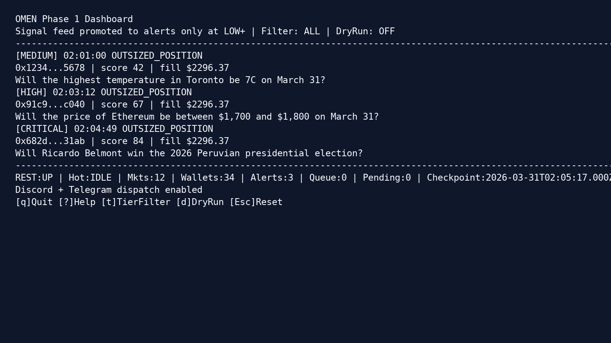
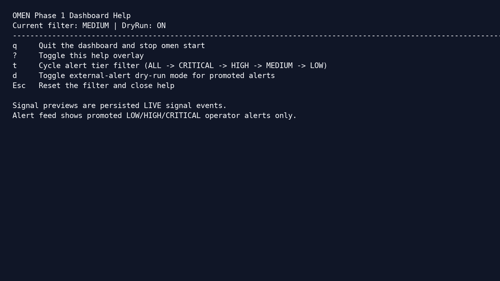

# Omen Bot

Polymarket ingest, live-signal, and operator-alert bot.

## Current State

- Polls recent Polymarket fills over REST and persists them into Postgres
- Dedupes fills on `(tx_hash, token_id)`
- Replays persisted `analyzed = false` fills through a hot worker
- Profiles wallets on the hot path with Alchemy-backed Polygon RPC calls
- Resolves controller attribution for contract wallets, with manual proxy overrides and conservative suppression when attribution is unavailable
- Falls back conservatively when Alchemy profiling is degraded so fills still complete without false fresh-wallet alerts
- Rebuilds wallet funding graphs through a BullMQ-backed cold worker when the live cache is missing or stale
- Persists LIVE `signal_events`, promoted alerts, alert deliveries, `audit_log`, and `ingest_quarantine`
- Emits `signal-preview` diagnostics during `start` and `replay`
- Promotes LOW+ composite scores into operator alerts
- Supports Telegram and Discord dispatch with per-channel market-scoped dedup
- Supports a Phase 1 terminal dashboard via `start --tui`
- Exposes runtime, admin, and validation commands including `start`, `replay`, `health`, `cold-worker`, `test-telegram`, `whitelist`, `proxy-override`, and `quarantine`
- Ships `omen:screen:*` and `omen:launchd:*` helpers for screen-managed local operation

Current LIVE signals:
- `FRESH_WALLET_LARGE_POSITION`
- `OUTSIZED_POSITION`
- `NICHE_MARKET_ENTRY`
- `CONVICTION_SIZE_MISMATCH`
- `LUMP_ENTRY`
- `SYBIL_CLUSTER`

The current runtime ships the broader recovered live-signal set. `OMEN-SPEC-v2.0` is still the forward-looking architecture reference, while `OMEN-SPEC-v1.8` remains the more detailed detector checklist.

Still deferred:
- Post-resolution scoring and retrospective analytics
- Richer investigation surfaces and backtesting/calibration work

Specs:
- [specs/OMEN-SPEC-v2.0.md](specs/OMEN-SPEC-v2.0.md)
- [specs/OMEN-SPEC-v1.8.md](specs/OMEN-SPEC-v1.8.md)
- [specs/OMEN-SPEC-v1.3-Legacy.md](specs/OMEN-SPEC-v1.3-Legacy.md)

## TUI

Rendered from the current dashboard renderer:





## Quick Start

The short version lives in [QUICKSTART.md](QUICKSTART.md). If you just want the minimum path:

```bash
pnpm install
cp .env.example .env
# edit .env and set ALCHEMY_API_KEY
docker compose up -d
pnpm exec tsx src/cli.ts health
pnpm exec tsx src/cli.ts start --tui
```

Important defaults:
- `.env.example` uses non-default local ports to avoid host collisions
- blank optional Telegram and Discord env vars are treated as unset
- `start --tui` requires an interactive TTY

Default local ports:
- Postgres: `localhost:15432`
- Redis: `localhost:16379`

## Commands

`start`
- Polls Polymarket REST for recent fills
- Inserts new fills into Postgres
- Queues pending fills into the hot worker
- Evaluates LIVE signals
- Writes `signal_events`
- Emits `signal-preview` diagnostics for every persisted LIVE signal event
- Promotes LOW+ composite scores into operator alerts
- Optionally dispatches Telegram and Discord alerts when configured and not in dry-run
- Marks fills `analyzed = true` only after hot-path work completes

`start --tui`
- Runs the same ingest and hot-worker path
- Replaces the headless JSON stream with the terminal dashboard
- Prefers promoted LOW+ alerts and falls back to recent LIVE signal previews when no alert has promoted yet

`replay`
- Reprocesses already-persisted fills where `analyzed = false`
- Useful after crashes, worker failures, or code fixes
- Re-emits `signal-preview` diagnostics and can dispatch any still-unsent operator alerts
- `{"type":"replay","replayed":0}` means there was no pending hot-path backlog

`health`
- Checks Postgres, Redis, Polymarket REST, Alchemy RPC, and the hot/cold worker heartbeats
- Reports runtime state such as queue depth, pending fill count, newest fill timestamp, and recent signal count

`cold-worker`
- Runs the BullMQ funding-graph rebuild worker as a standalone process
- Useful for debugging or operating the background rebuild path separately from `start`

`test-telegram`
- Sends a synthetic HIGH-tier Telegram alert through the configured Telegram bot/chat
- Uses the same Telegram formatter as production alerts
- Requires only `TELEGRAM_BOT_TOKEN` and at least one Telegram chat ID
- Does not require Postgres, Redis, or the hot worker

`whitelist`
- Lists or edits manual whale whitelist entries
- `add` requires `--address`, `--label`, and `--reason`
- `remove` requires `--address` and `--reason`

`proxy-override`
- Lists or edits manual controller overrides for contract wallets
- `set` requires `--address`, `--controller`, and `--reason`
- `clear` requires `--address` and `--reason`

`quarantine`
- Lists or inspects malformed Polymarket payloads captured in `ingest_quarantine`
- `list` accepts `--limit`
- `show` requires `--id`

Package helpers:
- `pnpm run omen:screen:start`, `omen:screen:attach`, `omen:screen:status`, `omen:screen:stop`
- `pnpm run omen:launchd:install`, `omen:launchd:status`, `omen:launchd:uninstall`

## What To Expect

Headless `start` emits JSON lines like:

```json
{"type":"ingest-cycle","checkpoint":"2026-03-31T01:53:07.000Z","fetched":566,"inserted":566,"replayed":101}
{"type":"signal-preview","fillId":"...","walletAddress":"0x...","marketId":"0x...","marketQuestion":"...","walletLiveScore":12,"walletLiveTier":"CLEAN","signal":{"signalId":"OUTSIZED_POSITION","availability":"LIVE","score":12,"confidence":0.8,"evidence":[...],"triggeredAt":"2026-03-31T01:59:11.495Z"},"dryRun":false}
{"type":"alert-dispatch","fillId":"...","walletAddress":"0x...","marketId":"0x...","signalId":"OUTSIZED_POSITION","walletLiveTier":"LOW","deliveryTier":"LOW","result":"sent","channels":["telegram","discord"],"failedChannels":[],"dryRun":false}
{"type":"runtime-stats","collectedAt":"2026-03-31T02:00:00.000Z","windowSeconds":60,"ingest":{"cycles":4,"fetched":12,"inserted":12,"replayAccepted":12},"hotWorker":{"enqueueAccepted":12,"enqueueDuplicate":0,"enqueueFull":0,"processed":12,"failed":0,"queueDepth":0,"pendingFillCount":0,"processing":false,"lastHeartbeatAt":"2026-03-31T01:59:59.991Z","lastProcessedAt":"2026-03-31T01:59:57.012Z","lastProcessedAgeMs":2988},"signals":{"previewCountsBySignalId":{"OUTSIZED_POSITION":3}}}
```

Interpretation:
- `fetched`: trades pulled from Polymarket in that cycle
- `inserted`: new fills written to Postgres
- `replayed`: pending fills the worker accepted for hot-path analysis in that cycle
- `signal-preview`: a LIVE signal fired for that fill and was persisted
- `alert-dispatch`: a promoted LOW+ operator alert was evaluated for external delivery
- `runtime-stats`: one-minute aggregate counters for ingest, worker throughput, backpressure, and signal volume

Important distinction:
- `signal-preview` is a diagnostic stream for every persisted LIVE signal event, including `CLEAN` outcomes
- Telegram and Discord only show promoted operator alerts where the wallet live tier is `LOW` or above
- The TUI alert feed prefers promoted operator alerts and otherwise falls back to recent LIVE signal previews
- `OUTSIZED_POSITION` by itself often stays diagnostic-only under the default score thresholds, which is expected

Practical expectations:
- The first run may backfill hundreds of fills
- `OUTSIZED_POSITION` should fire on real traffic now
- `FRESH_WALLET_LARGE_POSITION` now uses controller attribution for contract wallets when resolution succeeds; ambiguous contracts are suppressed conservatively
- `SYBIL_CLUSTER` uses a minimum fill gate so dust fills do not promote LOW alerts

## External Alerts

Optional env vars:

```bash
TELEGRAM_BOT_TOKEN=
TELEGRAM_CHAT_ID_CRITICAL=
TELEGRAM_CHAT_ID_MEDIUM=
DISCORD_WEBHOOK_CRITICAL=
DISCORD_WEBHOOK_MEDIUM=
```

Behavior:
- Leaving those blank disables the channel cleanly
- `dry_run = true` suppresses external delivery but still keeps local signal and alert visibility
- In the TUI, `d` toggles external-alert dry-run live
- Dedup is per channel and market scoped, so Telegram and Discord keep independent delivery state

## Useful Checks

Health while running:

```bash
pnpm exec tsx src/cli.ts health
```

Check fill backlog:

```bash
docker compose exec postgres psql -U omen -d omen -c "select count(*) filter (where analyzed = false) as unanalyzed from fills;"
```

Inspect recent fills:

```bash
docker compose exec postgres psql -U omen -d omen -c "select tx_hash, token_id, wallet_address, side, outcome, price, shares, size_usd, timestamp, analyzed from fills order by timestamp desc limit 10;"
```

Inspect recent wallet profiles:

```bash
docker compose exec postgres psql -U omen -d omen -c "select address, age_seconds, total_transactions, is_contract, live_suspicion_score, live_tier, updated_at from wallets order by updated_at desc limit 10;"
```

Inspect recent signal events:

```bash
docker compose exec postgres psql -U omen -d omen -c "select signal_id, wallet_address, market_id, score, confidence, created_at from signal_events order by created_at desc limit 20;"
```

Check dedupe integrity:

```bash
docker compose exec postgres psql -U omen -d omen -c "select tx_hash, token_id, count(*) from fills group by 1,2 having count(*) > 1 limit 10;"
```

That last query should return zero rows.

## Validation Commands

```bash
pnpm run typecheck
pnpm run test
pnpm exec tsx src/cli.ts health
pnpm exec tsx src/cli.ts start
pnpm exec tsx src/cli.ts start --tui
pnpm exec tsx src/cli.ts replay
pnpm exec tsx src/cli.ts validate-fills analyze --input .phase0-data/overnight-24h
```
