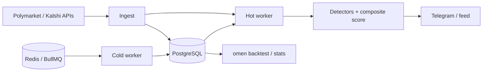

# Omen

A TypeScript research tool that flags informed-looking trading on [Polymarket](https://polymarket.com) and [Kalshi](https://kalshi.com). Detectors score unusual wallet and fill patterns; alerts are research signals, not a proven trading edge, and they do not mean a wallet or person traded on inside information.

## Architecture

TypeScript / Node 22 service. Postgres stores fills, profiles, signals, and outcomes. Redis backs a BullMQ cold-path worker (funding-graph rebuilds) plus queues and dedup. A hot path profiles wallets, runs detectors, and composes a live score. Promoted alerts can go to Telegram or Discord, or to a sibling feed process. `omen backtest` and `omen stats` grade signals offline and against live outcomes.



Sports markets are dropped before profiling. Weather markets are excluded by keyword. Likely market-makers are filtered out of live signals and baselines.

**Shipped detectors**

| Signal | Default role |
|---|---|
| `FRESH_WALLET_LARGE_POSITION` | Delivered (can alert) |
| `CONVICTION_SIZE_MISMATCH` | Delivered |
| `FRESH_WALLET_LONGSHOT` | Delivered |
| `NICHE_MARKET_ENTRY`, `OUTSIZED_POSITION`, `LUMP_ENTRY` | Score-only: they lift the composite score; their own alerts are stored and graded, not sent |
| `SYBIL_CLUSTER` | Shadow: stored and graded, not delivered, does not lift companion scores |
| Kalshi (`KALSHI_BLOCK_TRADE`, `CROSS_VENUE_DIVERGENCE`) | Ingested and graded; not delivered (`mute_kalshi`). Volume-spike and book-move detectors are off |

Tuning lives in `omen.config.toml`. Secrets stay in `.env` (see `.env.example`).

## Quick start

Needs Node 22+, [pnpm](https://pnpm.io), and Docker.

`package.json` depends on `@charr91/smart-money-feed`, a private sibling package used to publish alerts. `pnpm install` will fail without access to that repo. The TypeScript sources in this repository are still readable without it.

```bash
pnpm install
cp .env.example .env   # set ALCHEMY_API_KEY; leave Telegram/Discord blank to disable alerts
docker compose up -d   # Postgres on localhost:15432, Redis on localhost:16379
pnpm exec tsx src/cli.ts health
pnpm exec tsx src/cli.ts start --tui   # or: start  (JSON logs)
```

Set `[operational] dry_run = true` in `omen.config.toml` until you intend to send alerts. A longer operator walkthrough is in [QUICKSTART.md](QUICKSTART.md).

Useful commands: `omen replay`, `omen health`, `omen stats`, `omen backtest --offline`, `omen test-telegram`, `omen cold-worker`.

## Tests

```bash
pnpm test        # vitest
pnpm typecheck
```

## Status

Built and in use as a research stack: live ingest, detectors and composite scoring, outcome grading (`omen stats`), and an offline replay of publicly reported unusual-activity cases (`omen backtest`; committed write-up in [docs/backtests/m2-insider-cases.md](docs/backtests/m2-insider-cases.md)). No detector has a proven edge.

Specs under `specs/` are design references; this README and the committed config describe what actually ships.

## Disclaimer

Omen is a market-integrity research project. It surfaces unusual or informed-looking trading patterns for study. It does not accuse any wallet, handle, or person of insider trading or any other wrongdoing, does not offer investment advice, and does not claim that its signals are profitable or predictive.
